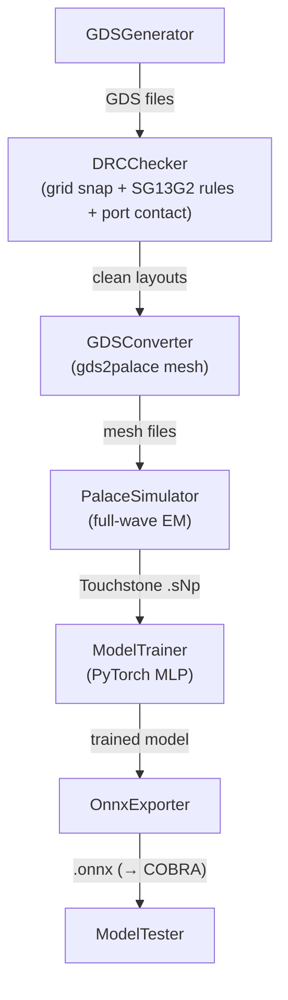

# Pipeline Stages

ORCA runs a linear pipeline. Each stage receives a context dictionary and adds its outputs for the next stage.



The sample-producing stages (`GDSGenerator`, `GDSConverter`, `PalaceSimulator`) record every finished sample in their parameter table right away and keep the results of earlier runs, so an interrupted run continues where it stopped when started again. Each of them takes `overwrite=True` to delete its earlier results instead; see [Resuming an interrupted run](running_orca.md#resuming-an-interrupted-run).

## Stage 1 — GDS generation (`GDSGenerator`)

Draws `num_samples` parameter combinations from the geometry's `input_parameter_iterator` (see [Custom Classes](custom_class.md#reference-inputparameteriterator)) and calls `create_gds_file()` for each.

- Combinations that `is_feasible()` rejects are replaced by further draws (not with the grid strategies). A `ValueError` in `create_gds_file()` costs a sample.
- `geometries/<name>_coverage.png` shows the layouts over the rejected draws for every two parameters (`plot_coverage=False` turns it off).
- The run seed (`ORCA.run(seed=...)`) makes the draws reproducible.

## Stage 2 — Design-rule check (`DRCChecker`)

Checks every layout with KLayout against the IHP SG13G2 back-end rules: grid, edge angles, metal width and spacing, and via size, spacing and enclosure. Findings carry the names of the SG13G2 design rule manual, e.g. `TV2.d`.

- `snap_to_grid=True` (default) first moves every vertex onto the `grid_nm` grid (5 nm).
- `drop_violations=True` (default) leaves layouts with violations out of the parameter table.
- `check_ports=True` (default) requires each port's marker to touch the metals the port connects. gds2palace does not check this, and such a port would simulate as an open circuit. These layouts are always dropped, and listed as `port<N>.missing` or `port<N>.open_<layer>`.

Writes `<name>_drc_report.csv` (counts per layout) and `<name>_drc.csv` (the layouts that passed) next to the GDS files.

## Stage 3 — GDS conversion (`GDSConverter`)

Turns each layout that passed DRC (or all of them, if the stage did not run) into a Palace model with [gds2palace](https://github.com/VolkerMuehlhaus/gds2palace_ihp_sg13g2), from the geometry's `stackup_xml`, `simconfig_filename` and `simulation_ports(params)`. Conversions run in parallel.

- A sample that cannot be meshed, or takes longer than `timeout` (180 s), is logged and skipped.
- A mesh whose worst element quality (gmsh's `minSICN`: 1 for a regular tetrahedron, 0 for a flat one) is at or below `min_element_quality` (`1e-6`) is left out, since Palace cannot solve it. If this happens often, the simcfg's `refined_cellsize` may be too coarse.
- Meshes below `warn_element_quality` (`1e-4`) are kept and listed in a warning. `palace_sims/<name>_mesh_report.csv` has the quality of every mesh.

## Stage 4 — EM simulation (`PalaceSimulator`)

Runs a full-wave Palace simulation per sample and writes its S-parameters as Touchstone files. `palace_executable` is a local binary or a container call (e.g. `apptainer exec palace.sif palace`); `num_processes` of `ORCA.run` sets the MPI ranks per simulation.

`num_parallel_sims` simulations run at once (0: as many as fit), each on a whole `"node"`, a `"socket"` or a `"numa"` domain (`bind`):

- `PalaceSimulator(num_parallel_sims=0, bind="numa")` runs one per NUMA domain of this machine, pinned with `numactl`. This usually gives the highest throughput if a simulation fits into the domain's memory.
- `PalaceSimulator(launcher="slurm", num_parallel_sims=0, bind="numa")` does the same on every node of a Slurm allocation; see [examples/slurm_runs](https://github.com/DI-PASSIONATE/ORCA/tree/main/examples/slurm_runs).

Each finished simulation adds its row to `results/<name>.csv`. A failed one is logged, left out and retried by the next run, and launches that Slurm refuses are retried after a delay. `save_log=True` keeps Palace's output in `palace.log`.

## Stage 5 — Model training (`ModelTrainer`)

Trains a PyTorch model that maps geometry and frequency to the S-parameters. The data is split by geometry, never by frequency point, and the split is recorded in `models/<name>_split.csv`. Without `hyperparameters`, Optuna tunes them first. The run seed fixes splits, tuning and initialisation.

| Argument | Default | Meaning |
|---|---|---|
| `model`, `basis` | `"mlp"`, `None` | Architecture, and an optional expansion of the inputs such as `"chebyshev"` |
| `hyperparameters` | `None` | A dict, or the path of a `models/<name>_hyperparameters.json` of an earlier run; skips tuning |
| `test_frac`, `val_frac` | 0.15, 0.15 | Share of geometries held out for `ModelTester`, and of the rest for choosing the best checkpoint |
| `n_fold_cv` | 5 | Cross-validation folds per tuning trial. 1 scores on the `val_frac` split: faster, and usually enough with a few thousand geometries |
| `n_trials`, `tuning_timeout` | 200, `None` | Tuning budget in trials and seconds |
| `max_epochs`, `tuning_max_epochs` | 100, 30 | Epoch limits, with early stopping |
| `batch_sizes` | 32 to 512 | Batch sizes searched; larger ones such as `[1024, 2048, 4096]` train per-point datasets faster |
| `regularization` | `False` | Also tune weight decay and dropout |
| `lr_schedule`, `warmup_epochs` | `"cosine"`, 1 | Learning-rate decay (`"plateau"` halves it when the validation loss stalls) after a linear warmup |
| `grad_clip_norm` | 1.0 | Gradient clipping; `None` disables it |
| `allow_tf32` | `False` | Faster, less precise matrix multiplies in training on recent GPUs; testing and export use FP32 |

Three optional loss terms judge the prediction as a circuit. They need a per-point dataset, as the presets have, and validation losses are only comparable between runs with the same settings:

| Argument | Meaning |
|---|---|
| `admittance_weight` | Adds the relative error of the admittance matrix, which decides L and Q; 0.1 to 1 is a useful range |
| `passivity_weight` | Penalises predictions that are more active than the simulated network |
| `above_srf_weight` | Weight of the points above each geometry's first self-resonance, relative to those below; for InductorOcta about 95 % of the points lie above |

## Stage 6 — ONNX export (`OnnxExporter`)

Exports the model to a self-contained `.onnx` file that runs with `onnxruntime` alone. Its metadata describes it to COBRA:

| Key | Content |
|---|---|
| `input_parameter_ranges` | Range of each input, with the `step` of integer inputs |
| `input_constraints` | The geometry's `feasibility_constraints()` |
| `physics_guarantees` | Properties the architecture enforces, such as reciprocity |
| `windings` | The geometry's `windings()`, if declared |
| `touchstone_type` | The Palace result the model was trained on: `normal`, `dc`, `deembedded` or `dc_deembedded` |
| `orca_version` | The exporting ORCA release, and its commit for a checkout |

## Stage 7 — Model testing (`ModelTester`)

Evaluates the trained (or exported) model on the held-out geometries of `models/<name>_split.csv`; without that file, on every result, with a warning.

- It reports the S-parameter error and the errors of the geometry's `electrical_parameters()`, such as L, Q and SRF, as median, 95th percentile and worst geometry, and per frequency band (`n_frequency_bands`).
- `models/<name>_test_errors.csv` has the errors of every geometry next to its parameters.
- `models/<name>_errors_vs_frequency.png` and `.csv` resolve the errors over frequency.
- Errors are relative, except for the parameters in `absolute_error_parameters`, such as the coupling factor k.

## Simulating one sample outside the pipeline

`simulate_geometry` runs stages 1, 3 and 4 for a single parameter set and returns the resulting network, for example to check a surrogate prediction against Palace. [COBRA](https://github.com/DI-PASSIONATE/COBRA)'s EM fine-tuning uses it.

```python
from orca import simulate_geometry
from orca.geometry.presets import InductorOcta

params = {"turns": 2, "width": 6.0, "space": 3.0, "diameter": 150.0}
ntwk = simulate_geometry(InductorOcta(), params, "output/check", name="check",
                         palace_executable="palace", num_processes=8)
```

It applies the pipeline's rules and raises `orca.SimulationError` when a step fails. By default it returns the most corrected Touchstone result (`dc_deembedded` if the sweep allows a DC point); `result_type` asks for another variant, falling back to the raw result. Meshing runs in a fresh process, so a script must call it under `if __name__ == "__main__":`.
